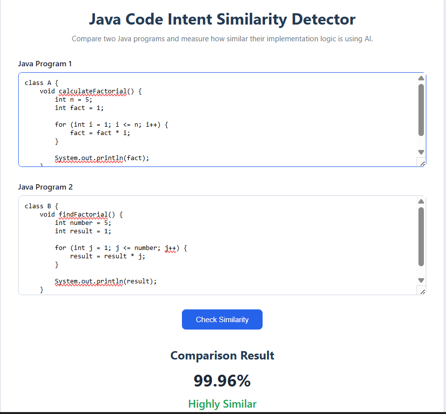
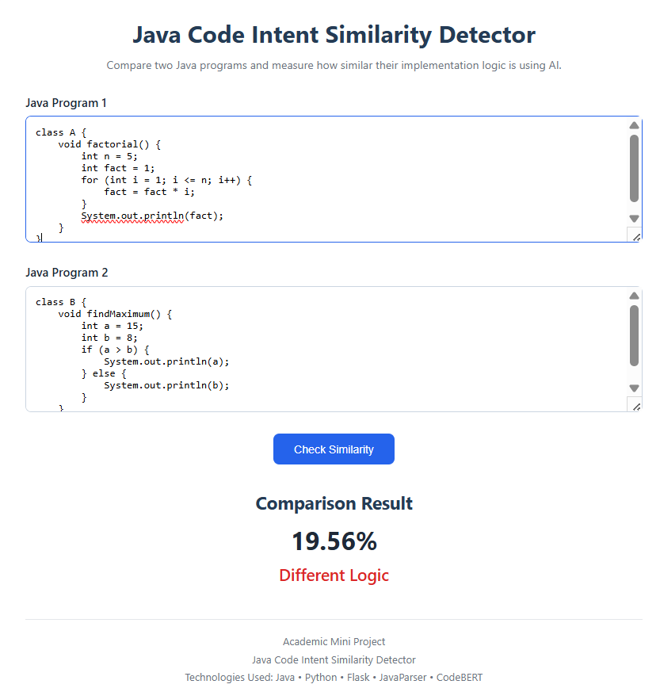

# Java Code Intent Similarity Detector

## Project Overview

This project compares two Java programs and measures how similar their implementation logic is.

Instead of comparing only the source code text, the project uses AI-based code embeddings to compare the programs and estimate their similarity.

The project combines Java, Python, JavaParser, Flask and CodeBERT to calculate a similarity score between two Java methods.

---

## How It Works

The basic working of the project is:

1. The user enters two Java programs.
2. JavaParser extracts the methods from the Java code.
3. The extracted methods are sent from Java to the Python server.
4. CodeBERT converts the code into numerical embeddings.
5. Cosine similarity is used to compare the embeddings.
6. Additional rule-based checks look for differences such as loops, addition and multiplication.
7. A final similarity score is calculated.
8. The result is displayed through the web interface.

### Basic Flow

```text
Java Programs
      ↓
JavaParser
      ↓
Method Extraction
      ↓
Python Flask API
      ↓
CodeBERT
      ↓
Code Embeddings
      ↓
Cosine Similarity
      ↓
Logic-based Checks
      ↓
Final Similarity Score
      ↓
Web Interface
```

---

## Features

- Extracts Java methods using JavaParser
- Converts Java code into embeddings using CodeBERT
- Compares code embeddings using Cosine Similarity
- Uses additional rule-based logic checks
- Provides a similarity percentage
- Shows whether the programs are highly similar, moderately similar or different
- Provides a simple web interface for testing Java programs

---

## Technologies Used

- Java
- Maven
- JavaParser
- Python
- Flask
- PyTorch
- Hugging Face Transformers
- CodeBERT
- HTML
- CSS

---

## Project Structure

```text
intent-sim/
│
├── screenshots/
│   ├── factorial-similar.png
│   ├── addition-vs-multiplication.png
│   └── factorial-vs-maximum.png
│
├── src/
│   └── main/
│       └── java/
│           └── com/
│               └── intentsim/
│                   ├── App.java
│                   └── MethodExtractor.java
│
├── python-api/
│   ├── app.py
│   └── templates/
│       └── index.html
│
├── .gitignore
├── pom.xml
└── README.md
```

---

## Sample Results

### 1. Same Logic - Factorial

Two different Java methods are used to calculate the factorial of a number.

**Result: 99.96% - Highly Similar**



---

### 2. Different Operations - Addition vs Multiplication

Both programs perform a simple calculation, but one uses addition while the other uses multiplication.

**Result: 59.96% - Moderately Similar**


---

### 3. Different Logic - Factorial vs Maximum

One program calculates a factorial using a loop, while the other finds the maximum of two numbers using an if-else condition.

**Result: 19.56% - Different Logic**



---

## How to Run

### 1. Start the Python Server

Open a terminal and go to the Python API folder:

```bash
cd python-api
```

Run:

```bash
python app.py
```

The Flask server should start at:

```text
http://127.0.0.1:5000
```

---

### 2. Run the Java Application

Open another terminal in the main `intent-sim` project folder.

Compile the project:

```bash
mvn clean compile
```

Then run:

```bash
mvn exec:java "-Dexec.mainClass=com.intentsim.App"
```

---

### 3. Open the Web Interface

Open the following address in a browser:

```text
http://127.0.0.1:5000/
```

Enter two Java programs and click **Check Similarity**.

---

## Example

### Program 1

```java
class A {
    void addNumbers() {
        int a = 10;
        int b = 20;
        int result = a + b;
        System.out.println(result);
    }
}
```

### Program 2

```java
class B {
    void sumValues() {
        int x = 10;
        int y = 20;
        int total = x + y;
        System.out.println(total);
    }
}
```

These programs use different variable and method names but perform the same basic operation.

---

## Limitations

The current version is a prototype and has some limitations:

- The project currently focuses on Java code.
- The current Java implementation extracts methods and compares the first extracted method.
- The rule-based logic checks use simple pattern matching.
- The penalty values are manually defined.
- CodeBERT has input length limitations.
- The similarity score should be treated as an estimate rather than proof that two programs are identical or copied.
- The project is intended for academic and learning purposes.

---

## Future Improvements

Some possible improvements are:

- Compare multiple methods in a Java file
- Improve logic detection using the Java AST
- Tune the rule-based penalties using a larger dataset
- Improve the user interface
- Add similarity reports
- Support more programming languages
- Improve the handling of larger Java programs
- Explore fine-tuning CodeBERT for code similarity tasks

---

## Academic Project

This project was developed as an academic mini project to explore Java programming, code parsing, APIs and AI-based code similarity.


## Live Demo

**[Try Java Code Intent Similarity Detector](https://java-code-similarity-5okb158f6-ben-jo28.vercel.app/)**

Compare two Java programs online and explore their estimated logical similarity without installing the project locally.

