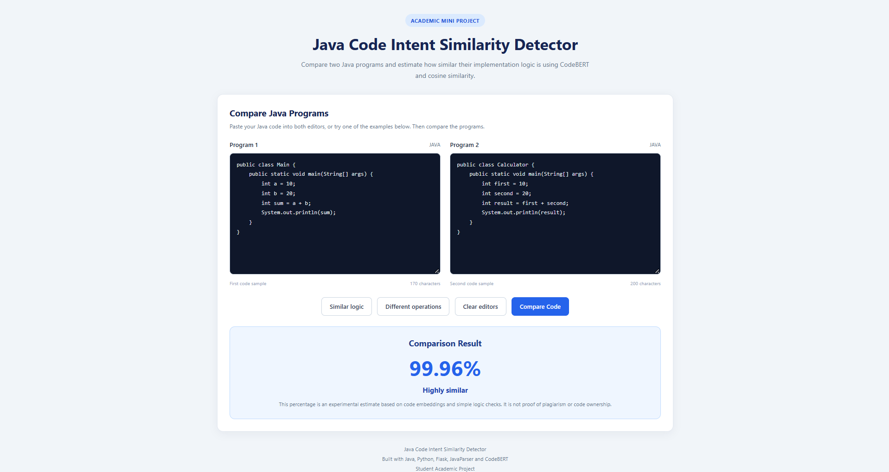
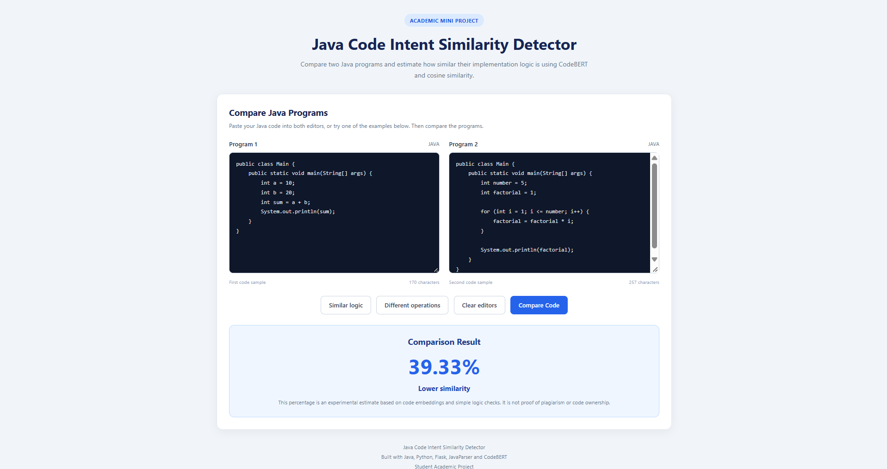

# Java Code Intent Similarity Detector

## 🚀 Live Demo

**[Try Java Code Intent Similarity Detector](https://java-code-similarity-5okb158f6-ben-jo28.vercel.app/)**

Compare two Java programs online and explore their estimated logical similarity without installing the project locally.

---

## Project Overview

This project compares two Java programs and estimates how similar their implementation logic is.

Instead of comparing only source-code text, the project uses AI-based code embeddings to estimate the semantic similarity between programs.

The project combines Java, Python, JavaParser, Flask, and CodeBERT to calculate a similarity score between two Java methods.

## How It Works

The basic workflow is:

1. The user enters two Java programs.
2. JavaParser extracts methods from the Java source code.
3. The extracted methods are sent from Java to the Python server.
4. CodeBERT converts the code into numerical embeddings.
5. Cosine similarity is used to compare the embeddings.
6. Additional rule-based checks look for differences such as loops, addition, and multiplication.
7. A final similarity score is calculated.
8. The result is displayed through the web interface.

### Basic Flow

```text
Java Programs
     ↓
JavaParser
     ↓
Method Extraction
     ↓
Python Flask API
     ↓
CodeBERT
     ↓
Code Embeddings
     ↓
Cosine Similarity
     ↓
Logic-Based Checks
     ↓
Final Similarity Score
     ↓
Web Interface
```

---

## Features

- Extracts Java methods using JavaParser.
- Converts Java code into embeddings using CodeBERT.
- Compares code embeddings using cosine similarity.
- Uses additional rule-based logic checks.
- Provides a similarity percentage.
- Displays an estimated similarity result.
- Provides a web interface for comparing Java programs.
- Includes sample programs for testing different code patterns.

---

## Technologies Used

- Java
- Maven
- JavaParser
- Python
- Flask
- PyTorch
- Hugging Face Transformers
- CodeBERT
- HTML
- CSS
- JavaScript
- Vercel

---

## Project Structure

```text
Java-Code-Similarity/
│
├── screenshots/
│   ├── similar-addition-logic.png
│   ├── addition-vs-factorial.png
│   └── addition-vs-multiplication.png
│
├── src/
│   └── main/
│       └── java/
│           └── com/
│               └── intentsim/
│                   ├── App.java
│                   └── MethodExtractor.java
│
├── python-api/
│   ├── app.py
│   ├── requirements.txt
│   ├── vercel.json
│   ├── .python-version
│   └── templates/
│       └── index.html
│
├── .gitignore
├── pom.xml
└── README.md
```

---

## Sample Results

The following screenshots demonstrate the application's interface and example comparisons.

### Similar Addition Logic

Two Java programs use different class and variable names but perform the same addition operation.



### Addition vs Factorial

One program performs addition, while the other calculates a factorial using a loop.



### Addition vs Multiplication

The programs perform different arithmetic operations, allowing the detector to estimate their similarity.

.png)

---

## How to Run Locally

### Prerequisites

Make sure you have the following installed:

- Java Development Kit (JDK)
- Maven
- Python
- Required Python dependencies

### 1. Start the Python Server

Open a terminal in the project directory and navigate to the Python API folder:

```bash
cd python-api
```

Install the dependencies:

```bash
pip install -r requirements.txt
```

Start the Flask server:

```bash
python app.py
```

The Flask server should be available at:

```text
http://127.0.0.1:5000
```

The first run may take some time because CodeBERT needs to download its model files.

### 2. Run the Java Application

Open another terminal in the main project directory.

Compile the project:

```bash
mvn clean compile
```

Run the Java application:

```bash
mvn exec:java "-Dexec.mainClass=com.intentsim.App"
```

### 3. Open the Web Interface

Open the following address in your browser:

[http://127.0.0.1:5000](http://127.0.0.1:5000)

Enter two Java programs and click **Compare Code** to view the estimated similarity result.

---

## Example

### Program 1

```java
class A {
    void addNumbers() {
        int a = 10;
        int b = 20;
        int result = a + b;
        System.out.println(result);
    }
}
```

### Program 2

```java
class B {
    void sumValues() {
        int x = 10;
        int y = 20;
        int total = x + y;
        System.out.println(total);
    }
}
```

These programs use different class, method, and variable names but perform the same basic operation.

The detector uses code embeddings and additional logic checks to estimate how similar the programs are.

---

## Limitations

The current version is a prototype and has some limitations:

- The project currently focuses on Java code.
- The Java implementation extracts methods and compares the first extracted method.
- The rule-based logic checks use simple pattern matching.
- The penalty values are manually defined.
- CodeBERT has input-length limitations.
- The similarity score is an estimate, not proof that two programs are identical or copied.
- The project is intended for academic and learning purposes.

---

## Future Improvements

Possible improvements include:

- Comparing multiple methods in a Java file.
- Improving logic detection using the Java Abstract Syntax Tree (AST).
- Tuning rule-based penalties using a larger dataset.
- Improving the user interface.
- Adding downloadable similarity reports.
- Supporting more programming languages.
- Improving handling of larger Java programs.
- Exploring fine-tuning CodeBERT for code-similarity tasks.

---

## Source Code

The complete source code is available on GitHub:

**[Java Code Intent Similarity Detector — GitHub Repository](https://github.com/BenettJohn/Java-Code-Similarity)**

## Academic Project

This project was developed as an academic mini project to explore Java programming, source-code parsing, API integration, and AI-based code similarity.
